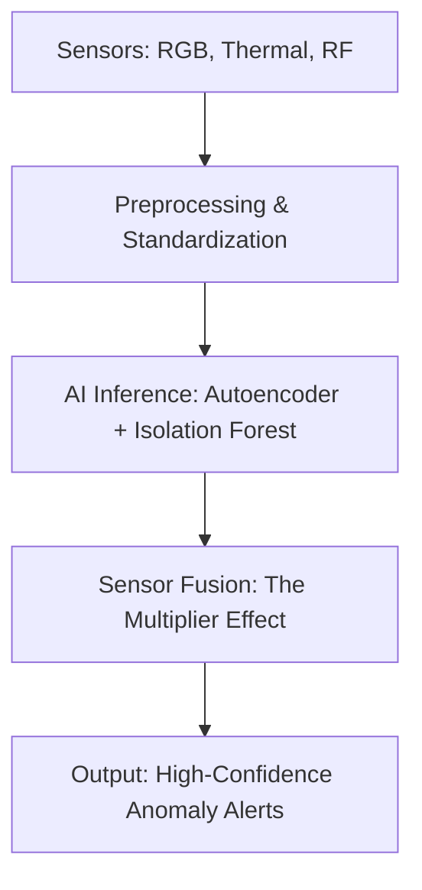

# PARALLAX: AI-Based Multi-Sensor Anomaly Detection System

> **"Detecting what shouldn't exist — even when it cannot be seen."**

---

## 👁️ The Philosophy: Beyond the Limits of Visibility

Modern surveillance systems suffer from a fundamental, critical blind spot: **they rely entirely on knowing what they are looking for.** Traditional security frameworks depend on visual recognition (RGB cameras) or thermal visibility (infrared sensors). If a target employs advanced camouflage, stealth materials, or blends perfectly into its surroundings, traditional object detection models (like YOLO or SSD) fail because they cannot classify what they cannot explicitly define.

**PARALLAX shifts the paradigm from Object Detection to Anomaly Inference.**

Rather than trying to recognize a threat signature, PARALLAX maps the baseline signature of a static environment and detects **statistical deviations**. Every physical object, no matter how stealthy or disguised, inevitably disturbs its environment. PARALLAX captures these subtle environmental footprints across multiple spectrums:
*   **RF Shadows:** Electromagnetic signal attenuation and multi-path disturbances.
*   **Temperature Shifts:** Minute thermal anomalies caused by body heat, engines, or material insulation differences.
*   **Texture Disruptions:** Spatial variance and edge-frequency anomalies in the visual field.

---

## 🛠️ The Multi-Layered Detection Pipeline

PARALLAX processes data through a real-time, four-stage pipeline:



1.  **Sensor Acquisition:** Continuous ingestion of high-frequency streams:
    *   *Vision:* RGB textures and optical flow.
    *   *Thermal:* Localized heat inconsistencies.
    *   *RF:* RF signal attenuation and shadow metrics.
2.  **Processing & Alignment:** Aligning multi-modal streams temporally and spatially.
3.  **AI Models (Anomaly Inference):**
    *   **Autoencoders (Deep Learning):** The neural network learns a compact, reconstruction-based representation of the "normal" baseline scene. When an anomaly is introduced, the network fails to reconstruct it accurately, producing a high **reconstruction error** that maps to the anomaly.
    *   **Isolation Forests (Statistical):** Quickly isolate outlier values in tabular multi-sensor data points.
4.  **Sensor Fusion (The Multiplier Effect):**
    Combining weak, isolated alerts (e.g., a slight drop in RF strength paired with a minor, localized temperature shift) to generate a high-confidence threat detection where individual sensors would have flagged nothing.

---

## 💻 Tech Stack & Project Architecture

This workspace is divided into two primary subcomponents:
1.  **`demo/`:** A real-time vision-only MVP implementation of the PARALLAX pipeline utilizing a PyTorch Autoencoder backend and a React dashboard.
2.  **`land/`:** The product landing portal showcasing the vision, capabilities, and system specifications.
3.  **`ppt/`:** Project presentations and demonstration assets.

### Workspace Directory Layout

```
PARALLAX/
├── .gitignore
├── README.md
├── demo/                        # Vision-Only MVP
│   ├── anomaly_detector.py      # PyTorch Autoencoder + OpenCV Inference Engine
│   ├── backend.py               # FastAPI Local Server with WebSocket Streaming
│   ├── model.py                 # PyTorch ConvAutoencoder & DifferenceClassifier
│   ├── auth.py                  # OAuth2 security and SQLite backend integration
│   ├── requirements.txt         # Python dependencies
│   ├── start.bat                # Dev script to launch backend & frontend
│   └── frontend/                # React Dashboard UI
│       ├── src/
│       │   ├── pages/           # Home dashboard and documentation portals
│       │   └── App.jsx          # App entrypoint and routing
│       └── package.json
├── land/                        # Static Landing Page Portal
│   ├── index.html               # Dual-Tone Immersive Web Portal
│   └── netlify.toml / vercel.json
└── ppt/                         # Presentation & Media Assets
```

---

## ⚙️ Vision-Only MVP (`demo`) Setup & Execution

The vision-only MVP showcases the core logic of learning a baseline environment and highlighting deviations in real-time.

### Prerequisites

*   Python 3.10+
*   Node.js (for React frontend)
*   A functional built-in or USB webcam

### Installation

1.  **Set up the Python Backend:**
    ```bash
    cd demo
    pip install -r requirements.txt
    ```
2.  **Set up the React Frontend:**
    ```bash
    cd frontend
    npm install
    ```

### Running the MVP

You can boot both the FastAPI backend and the Vite dev server concurrently using the startup script:
```bash
start.bat
```

Alternatively, run them in separate terminals:

*   **Backend:**
    ```bash
    cd demo
    python -m uvicorn backend:app --host 127.0.0.1 --port 8000
    ```
*   **Frontend:**
    ```bash
    cd demo/frontend
    npm run dev
    ```

---

## 🧠 Core Algorithmic Mechanics

### 1. Autoencoder Anomaly Mapping
The `ConvAutoencoder` in `model.py` compresses the image to a low-dimensional bottleneck and attempts to reconstruct it.
$$\text{Reconstruction Error} = \| x - f(g(x)) \|^2$$
Where $g(x)$ is the encoder and $f(z)$ is the decoder. Anomalous areas exhibit high MSE values, which are thresholded and mapped as spatial bounding boxes.

### 2. The Multiplier Effect
In the full sensor fusion version, the system computes a joint probability of anomaly across $K$ sensor streams:
$$P(\text{Anomaly}) = 1 - \prod_{i=1}^K (1 - P_i(\text{Anomaly}))$$
This ensures that even if three independent sensors only report a weak $P_i = 0.3$, the fused anomaly confidence surges to:
$$P(\text{Anomaly}) = 1 - (0.7 \times 0.7 \times 0.7) = 1 - 0.343 = 0.657 \quad (\text{Suspicious/Anomaly status})$$
